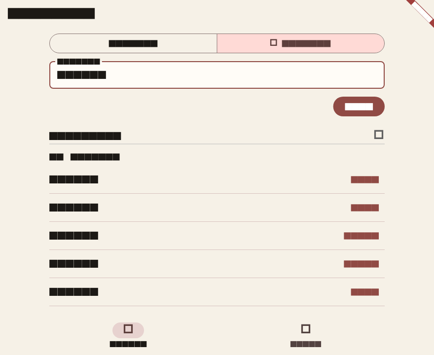
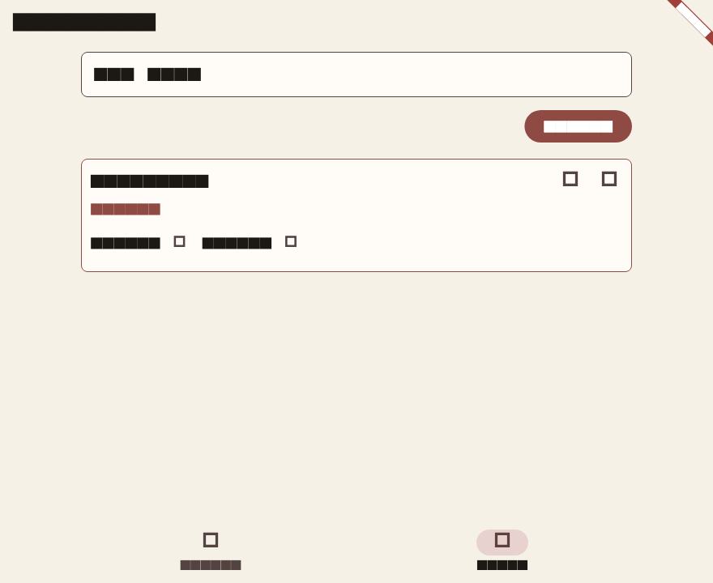

# Wordloom

A local workshop for pattern search, letter search, and saved word lists. The dictionary ships with the app and stays on the device.

Pattern mode treats `?` as one unknown letter. `c?t` returns cat, cot, and cut.

Letter mode returns words you can spell from the letters you type. `listen` returns listen, silent, enlist, tinsel, inlets, and the shorter words that fit those letters.

Saved lists support create, rename, add, remove, and delete. The active list is the one new matches are saved into.





## Run

```bash
flutter pub get
flutter run
```

## Checks

```bash
flutter analyze
flutter test
flutter build web
```

`integration_test/workshop_test.dart` repeats the pattern search against the bundled word list on a desktop or mobile device. The Chrome device is not supported for that runner.
